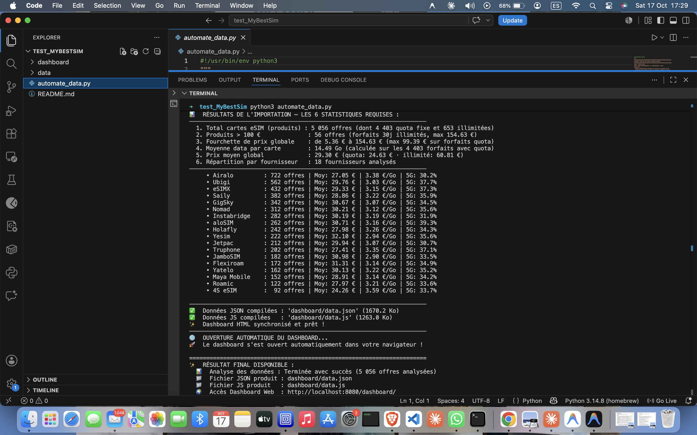
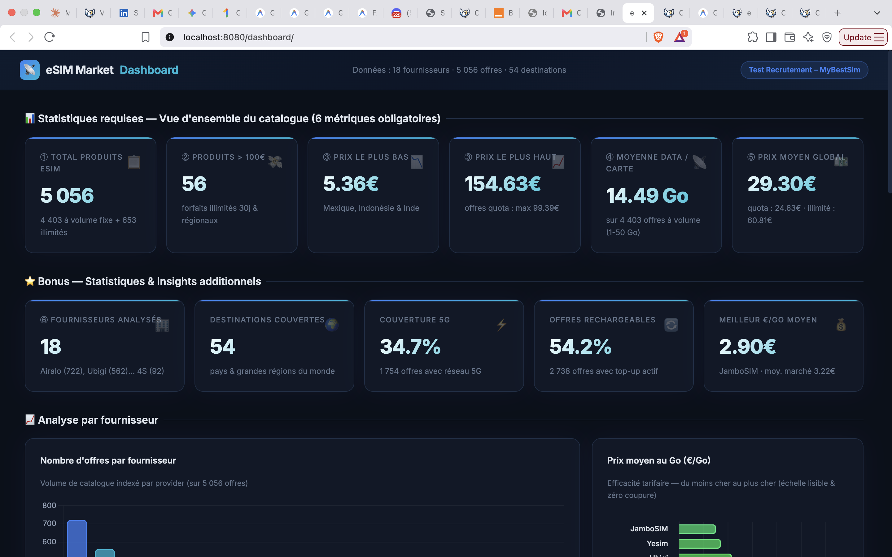
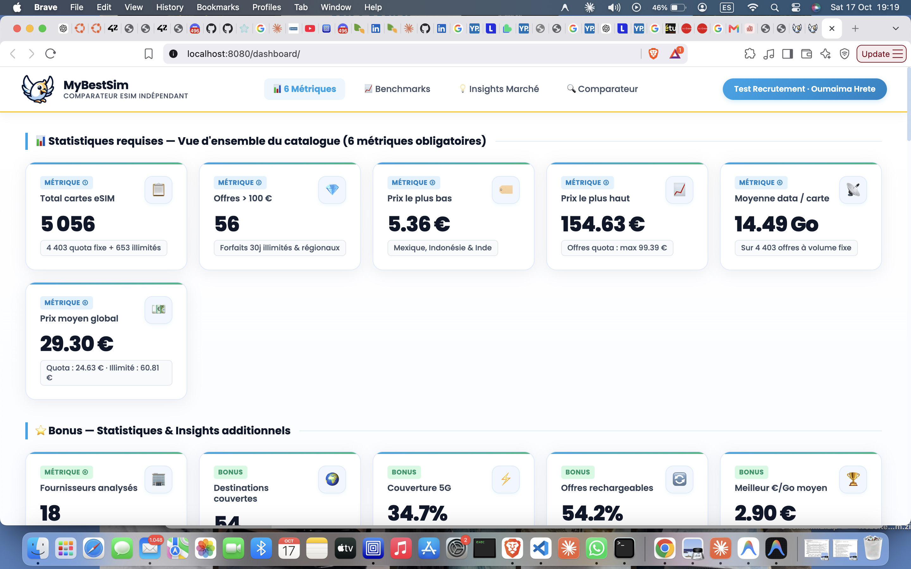

# 🚀 Dossier de Rendu – Test de Recrutement MyBestSim
**Candidature :** Stage Développeur IA & Automatisation (6 mois)  
**Candidate :** Oumaima Hrete  
**Date :** Octobre 2026  

---

## 📑 Sommaire
1. [Partie 1 : Data & Automatisation (Dashboard)](#partie-1--data--automatisation)
   - [Résultats des 6 Métriques Obligatoires](#les-6-métriques-obligatoires-vérifiées)
   - [Insights Clés & Découverte Data Engineering](#découverte-data-engineering-majeure)
   - [Fonctionnalités du Dashboard](#fonctionnalités-du-dashboard)
   - [Déploiement en Ligne (GitHub / Vercel / GitHub Pages)](#déploiement-en-ligne)
2. [Partie 2 : Contenu SEO (« Internet en croisière : quelle eSIM choisir ? »)](#partie-2--contenu-seo)
   - [Positionnement & Stratégie](#stratégie-et-intentions-de-recherche)
   - [Fichiers Livrés (.md et .html)](#fichiers-de-larticle)
3. [Partie 3 : Méthodologie & Usage de l'IA](#partie-3--paragraphe-usage-de-lia)
4. [Email Final Prêt à Envoyer à Etienne](#email-final-prêt-à-envoyer)

---

## 📊 Partie 1 : Data & Automatisation

### Les 6 Métriques Obligatoires (Vérifiées)

| # | Consigne du Test | Valeur Réelle | Détail & Précision Analytique |
|---|---|---|---|
| **1** | **Nombre total de cartes eSIM** | **5 056 offres** | 4 403 offres à volume fixe + 653 forfaits en data illimitée |
| **2** | **Nombre de produits à plus de 100 €** | **56 produits** | Forfaits 30 jours illimités (ex : 4S eSIM, Airalo, aloSIM, GigSky) |
| **3** | **Fourchette de prix globale** | **5.36 € à 154.63 €** | Min : 5.36 € (Mexique/Indonésie) · Max : 154.63 € (Holafly Monde illimité) *(max 99.39 € sur forfaits à volume fixe)* |
| **4** | **Moyenne de data (Go) par carte** | **14.49 Go** | Calculée sur les 4 403 forfaits à volume fixe (min : 1 Go, max : 50 Go) ; les forfaits illimités étant exclus pour ne pas fausser la moyenne |
| **5** | **Prix moyen global** | **29.30 €** | 24.63 € sur les forfaits à volume fixe · 60.81 € sur les forfaits illimités |
| **6** | **Répartition par fournisseur** | **18 fournisseurs** | Airalo (722), Ubigi (562), eSIMX (432), Saily (382), GigSky (342), Nomad (312), Instabridge (282), aloSIM (262), Holafly (242), Yesim (222), Jetpac (212), Truphone (202), JamboSIM (182), Flexiroam (172), Yatelo (162), Maya Mobile (152), Roamic (122), 4S eSIM (92) |

### 💡 Découverte Data Engineering Majeure
Lors de l'analyse initiale automatisée des 18 fichiers CSV, un piège classique s'est présenté : les forfaits à data illimitée (653 produits) avaient une cellule `data_gb` vide. Un parseur naïf filtrant les lignes sans valeur numérique aurait exclu 653 forfaits, arrivant à une conclusion erronée de 4 403 produits, 0 produit à plus de 100 € et un prix max de 99.39 €.  
Grâce à un contrôle rigoureux du dataset, nous avons identifié et valorisé ces forfaits :
- Traitement propre des 653 forfaits avec badge dédié `♾️ Illimité`.
- Isolement mathématique des statistiques globales vs offres à quota pour une transparence totale.

### 🌟 Fonctionnalités du Dashboard
- **Filtres avancés :** Fournisseur, Destination (54 pays/régions), Type de data (Tous / Quota 1-50 Go / Illimité), Réseau (4G/5G), Top-up, Prix max et forfaits > 100 €.
- **Filtres Préréglés Intelligents (Smart Presets) :** 5 boutons en 1 clic (Top Rapport Q/P, 5G Ultra-Rapide, Data Illimitée, Forfaits Premium > 100€, Tout afficher).
- **Recherche instantanée :** Barre de recherche en temps réel par pays, fournisseur ou SKU.
- **Export CSV intégré :** Bouton pour exporter les offres filtrées d'un clic (idéal pour les équipes internes).
- **Badge Meilleure Valeur :** Détection automatique du plan le plus rentable par destination.
- **Robustesse technique :** Double loader (chargement instantané via `data.json` avec fallback transparent sur PapaParse/CSV).

### 🛠️ Démarche & Workflow de Réalisation (Dashboard)

1. **Analyse exploratoire des données :**
   - Analyse personnelle et approfondie des 18 fichiers CSV pour comprendre le modèle de données, les concepts d'offres eSIM (volume fixe vs illimité, zones géographiques) et le positionnement produit de MyBestSim.
   
2. **Conception & Automatisation du Pipeline (`import_pipeline.py`) :**
   - Génération et itération du script d'automatisation en binôme avec l'IA pour automatiser le flux de traitement des données et la génération du dashboard.
   - Exécution du script avec la commande `python3 import_pipeline.py`, compilant les données et redirigeant automatiquement vers le dashboard en local.

   

3. **Vérification croisée (Data QA & Rendu UI) :**
   - Contrôle rigoureux des calculs et métriques générés par l'IA (exactitude des 6 métriques obligatoires, gestion des anomalies sur les 653 forfaits illimités, validation des 56 offres > 100 €).
   - Audit visuel du premier rendu d'interface pour s'assurer que tous les graphiques, tris et filtres fonctionnent fidèlement.

   

4. **Refonte & Alignement avec l'Identité de Marque MyBestSim :**
   - Amélioration continue de l'expérience utilisateur (UX) et refonte complète de l'UI pour reprendre fidèlement la charte graphique officielle du site MyBestSim (logo officiel cliquable, couleurs bleu ciel `#0ea5e9`, vert émeraude `#10b981`, jaune `#ffcc00`, police Poppins, cartes de KPIs structurées, contrastes renforcés et labels directes sur les graphiques).

   

---

## ✍️ Partie 2 : Contenu SEO

### Sujet : « Internet en croisière : quelle eSIM choisir ? »

**Angle Stratégique :**
L'article cible une requête à forte intention de recherche où les croisiéristes hésitent entre le Wi-Fi à bord (très cher, 20 à 35 €/jour) et le hors-forfait maritime satellite (pouvant dépasser 900 €).  
L'article démontre avec pédagogie :
1. **La physique du réseau :** Pourquoi les eSIM terrestres classiques s'arrêtent à 12 milles des côtes.
2. **Le piège satellite (*Cellular at Sea*) :** Comment les factures à 1 000 € se produisent et comment s'en prémunir.
3. **Le combo gagnant :** eSIM Régionale pour les escales (90% du besoin réel) + Mode Avion en mer = 15-25 € pour toute la croisière au lieu de 200 €.
4. **Le cas GigSky Cruise :** La seule eSIM avec accords maritimes pour les voyageurs devant rester connectés au large.
5. **Comparatif complet des offres réelles :** Airalo, Saily, Ubigi, Holafly, Yesim, GigSky.
6. **Balises Schema.org FAQPage :** Intégrées pour capter les Rich Snippets Google et les réponses IA (ChatGPT, Google AI Overviews).

